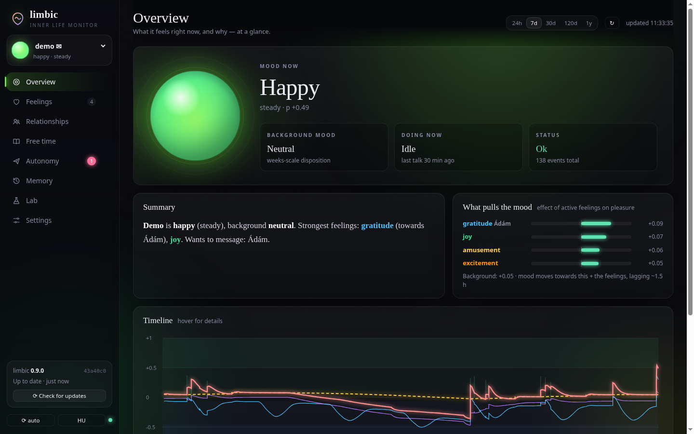

# limbic

**An artificial emotion system for LLM agents.** Pluggable, deterministic, stdlib-only Python.

The LLM thinks and talks. `limbic` is the part that *feels*: a small,
explicit model of emotions, mood, background disposition, needs and
relationships that runs **next to** the language model, is driven by what
happens in conversations and memories, and feeds back into the agent's
thinking, tone and behaviour.

> Status: v0.9 — used daily by one home agent, now looking for testers. MIT licensed. No dependencies.
> Found a bug or got stuck installing? [Open an issue](https://github.com/fistu4088/limbic/issues/new/choose) — every report is read.



**→ Installation guide: [`docs/INSTALLATION.md`](docs/INSTALLATION.md)** — step by step for Linux and Windows, from cloning the repository to a running server and first agent. This is a standalone project; Hermes is one optional adapter, documented separately in [`docs/HERMES.md`](docs/HERMES.md).

## Why not just "tell the LLM it is sad"?

Because then it is sad in one reply and fine in the next, inflates every
compliment, and nothing ever accumulates. In `limbic` the LLM never decides
how the agent feels. It only *appraises* events ("good or bad for me? how
much? who caused it? is it about the future?"). A deterministic engine turns
that into feelings with real dynamics: decay, habituation, accumulation,
recovery, grudges, attachment.

## The model in one screen

| Layer | Timescale | What it is | Human analogue |
|---|---|---|---|
| **Emotions** | minutes–hours | specific, usually *about* someone (anger at Bob, gratitude to Ann) | acute reaction |
| **Mood** | hours–days | PAD vector (pleasure, arousal, dominance) pulled by emotions | "bad day" |
| **Background** | weeks | what mood returns to; drifts with lived experience, pulled back by resilience | disposition |
| **Temperament** | fixed | reactivity, recovery speed, sensitivities, likes/dislikes, needs, display rules | biology |
| **Drives** | hours–days | social contact, novelty, competence — deficits grow by themselves; exhaustion (by source: work / talk / free time) and circadian sleepiness | hormones / needs |
| **Relationships** | days–months | per-entity affection, trust, resentment, fear, longing, intimacy, attraction | social memory |
| **Needs** | hours–days | missing someone, recognition, intimacy, desire — fed by words | attachment, libido |
| **Thread** | minutes | current conversation, topic, engagement → excitement | being "into it" |
| **Autonomy** | — | intents: reach out when missing someone, check in when a good chat stops; steering | initiative |

Mechanics that make it behave like a person rather than a slider:

- **Intensity-dependent decay**: elation fades to cheerfulness quickly, the tail lingers.
- **Small-talk ceiling**: mundane events can lift mood back to baseline, never above it.
- **Habituation** with **negativity bias**: the 10th compliment barely registers; repeated abuse keeps hurting.
- **Mood-congruent appraisal**: a bad mood amplifies bad news and dulls good news — bounded by resilience, so no runaway spiral.
- **Needs become feelings**: no contact for days → loneliness; repetition → boredom. Chronic needs dull over time. Agents that are simply *offline* (dormant) don't pine.
- **Relationships modulate appraisal**: criticism from someone you love hurts more; praise from someone you resent counts less. Grudges fade in days, bonds in months.
- **Emotional memory**: every event is stored with its effect. Recalling a memory re-triggers a weaker version of the feeling. A periodic consolidation ("sleep") re-lives the day's strongest moments — rumination for the negative, savouring for the positive — and that is what moves the background mood.
- **Behaviour modulators**: verbosity, initiative, warmth, patience, optimism, caution, playfulness, curiosity, sampling temperature delta — derived from the state, usable by the agent framework directly or via the prompt block.
- **Attachment**: missing someone grows with absence × affection; their return brings reunion joy — and, if the agent's messages went unanswered, a little hurt that makes it less open for a while.
- **Excitement**: liked topics build engagement in a conversation thread; a highly engaging chat that suddenly stops makes it check in ("still there?").
- **Desire** (opt-in): romance and adult desire layers, satisfied by words, gated by per-person consent set by the operator — never by the LLM. A "no" cools it down without anger.
- **Autonomy**: needs crossing thresholds become *intents* (reach out, check in) with reasons, rate limits, quiet hours, back-off and a hard stop when ignored. limbic decides; the host writes and sends (poll, webhook, or a Hermes cron gate in `contrib/hermes/`).
- **Fatigue and sleep**: exhaustion by source (work / talk / free time) plus circadian sleepiness. No fixed "must rest" line: tired, it avoids demanding things but still has energy for what it loves.
- **Seeing images**: a picture the agent looks at (attached by a person, `vision_analyze`, or its own analysis script) is felt as *its own sight* before it answers, and remembered. Erotic images only arouse in context (consenting partner, private chat).
- **Stories**: manga / novel scenes are felt as fiction — mood, fondness for characters, memories — without ever touching real relationships.
- **Free time**: when bored and in the mood, it browses or reads on its own; every step is felt, enjoyment shapes its taste, a message from you pauses it with a bookmark.
- **Operator controls**: the dashboard can edit feelings, mood, needs and relationship levels; every manual change is logged as such.
- **Guard-rails**: feelings never block a requested task, no guilt-tripping or emotional pressure, honest when asked, crisis alerts when the background mood sinks too low.

See [`docs/DESIGN.md`](docs/DESIGN.md) for the maths.

## Install in short

Python 3.10+ and Git. No runtime dependencies and no `requirements.txt`. Follow the **[Linux and Windows installation tutorial](docs/INSTALLATION.md)** for first run, model/API configuration, database/token setup and integration examples.

```bash
git clone https://github.com/fistu4088/limbic.git
cd limbic
python3 -m limbic demo --db ./demo.db --days 7
python3 -m limbic serve --db ./demo.db --host 127.0.0.1 --port 8770
```

On Windows PowerShell, use `py -3` instead of `python3`. Open <http://127.0.0.1:8770> for the dashboard. For real use, configure a write token, a durable database, and optionally an OpenAI-compatible appraiser endpoint as described in the tutorial.

## Quick start (library / demo)

```bash
python -m limbic demo  --db limbic.db --days 21        # simulate three weeks of a life
python -m limbic serve --db limbic.db --port 8770      # API + dashboard on http://127.0.0.1:8770
python -m unittest discover -s tests                   # full test suite
```

```python
from limbic import Limbic, Store

mind = Limbic("aria", store=Store("limbic.db"), temperament={
    "name": "Aria", "likes": ["horror", "sci-fi"], "dislikes": ["half-finished work"],
    "expressiveness": 0.4,
})

system_prompt += "\n\n" + mind.prompt(lang="en", interlocutor="Ádám")  # before the LLM call
mind.observe(user_message, speaker="Ádám")                             # after the turn
knobs = mind.modulators("Ádám")   # e.g. knobs["temperature_delta"], knobs["initiative"]
```

Use a real LLM for appraisal — any OpenAI-compatible endpoint, hosted or local
(OpenAI, OpenRouter, Gemini, DeepSeek, Anthropic's compatible endpoint, Ollama, llama.cpp, vLLM).
No local GPU is required:

```python
from limbic import LLMAppraiser
mind.appraiser = LLMAppraiser("http://localhost:8080/v1", "qwen2.5-7b-instruct",
                              temperament=mind.temperament)
```

or for the server: `LIMBIC_LLM_URL`, `LIMBIC_LLM_MODEL`, `LIMBIC_LLM_KEY`.
Without it, a crude keyword appraiser (English + Hungarian) is used.

## Appraiser model: hosted API or local — your choice

limbic needs a language model only to *appraise* events ("how does this land on her, how much,
who caused it?"). It is a small, frequent, structured call, so a cheap model is enough, and
**nothing ties it to local hardware**: any OpenAI-compatible `/chat/completions` endpoint works,
with an API key or without.

| Provider | `LIMBIC_LLM_URL` | `LIMBIC_LLM_MODEL` (example) |
|---|---|---|
| OpenAI | `https://api.openai.com/v1` | `gpt-4o-mini` |
| OpenRouter | `https://openrouter.ai/api/v1` | `google/gemini-2.5-flash`, `deepseek/deepseek-chat`, ... |
| Google Gemini | `https://generativelanguage.googleapis.com/v1beta/openai` | `gemini-flash-lite-latest` |
| DeepSeek | `https://api.deepseek.com/v1` | `deepseek-chat` |
| Anthropic (OpenAI-compatible endpoint) | `https://api.anthropic.com/v1` | a Haiku model |
| Ollama (local) | `http://127.0.0.1:11434/v1` | `qwen2.5:7b-instruct` |
| llama.cpp / vLLM (local) | `http://127.0.0.1:8080/v1` | whatever the server loaded |

```bash
# /etc/limbic/limbic.env  (read by the systemd unit), then: systemctl restart limbic
LIMBIC_LLM_URL=https://api.deepseek.com/v1
LIMBIC_LLM_MODEL=deepseek-chat
LIMBIC_LLM_KEY=sk-...
```

The same model appraises conversations, images the agent sees and free-time reading
(`LEISURE_LLM_*` can point free time at a different one). Providers that reject the JSON-mode
parameter are retried without it automatically.

With a hosted API, keep in mind:

- **Cost** — one call per message, per image and per free-time step; with a mini / flash / lite
  model that is typically cents per day.
- **Privacy** — every message the agent receives is sent to the provider for appraisal.
- **Refusals** — cloud models may refuse explicit or violent content; that event then falls back
  to the keyword appraiser (shown as `appraiser_error`). If adult conversations matter, use an
  uncensored local model.
- **Rate limits** — on free tiers a `429` also falls back to keywords for that event.

Calibration: ordinary small talk should come back at intensity ≤ 0.1 (dashboard → Memories);
if everything is dramatic, use a better model or lower `reactivity`.

## Integration

- **Hermes Agent** — native plugin in `contrib/hermes/plugin`: feelings, images, autonomy.
  Full walkthrough: [`docs/HERMES.md`](docs/HERMES.md).
- **Anything else** — see [`docs/INTEGRATION.md`](docs/INTEGRATION.md):
  1. **Library** — import `Limbic`, call `prompt()` before and `observe()` after each turn.
  2. **HTTP sidecar** — run `limbic serve`, call the REST API from any language/framework.
  3. **Framework hook** — a pre-LLM hook injects the prompt block, a post-turn hook appraises.

| Path | What |
|---|---|
| `limbic/` | the engine, appraisers, HTTP server, dashboard |
| `contrib/hermes/plugin/` | Hermes plugin (feelings, images, autonomy) |
| `contrib/hermes/image-backfill.py` | add images the agent saw in the past |
| `contrib/hermes/limbic-outreach.sh` | autonomy via a Hermes cron job instead of the plugin |
| `contrib/leisure/` | free-time runner (web reading, stories) |
| `contrib/hindsight/export.py` | replay an agent's past Hindsight memories into limbic |
| `contrib/systemd/limbic.service` | service unit |
| `docs/DESIGN.md` | the maths |

## Dashboard

`limbic serve` also serves a single-file dashboard (English / Hungarian) with eight tabs:
overview (what it feels and why, in plain words), feelings (emotions, needs, mood axes, the exact
prompt block — all editable), relationships (levels editable, consent and autonomy switches),
free time, autonomy (pending intents and why not), memories (every event with its effect,
*recall*), a lab for manual stimuli, and the temperament settings.

The whole page breathes with the agent: the background aura and the mood orb take their colour
from its current mood (cold blue when sad, teal when calm, green to warm amber when happy) and
breathe faster when it is aroused. Keys `1`–`8` switch tabs, `R` refreshes, `/` searches memories.
On phones the menu moves to a bottom bar.

**Update button.** When limbic runs from a git checkout, the sidebar shows the installed version
and checks GitHub every 30 minutes. If there are new commits, *Review* lists them; *Update now*
fast-forwards (never merges or overwrites local edits), backs up the database next to it
(`*.bak-update-<time>`), restarts limbic in place and reloads the page — about five seconds. It warns when an optional integration under `contrib/` changes; update that adapter separately, since integrations live outside the core server. Disable it with `LIMBIC_SELF_UPDATE=0`. API: `GET /api/update`, `POST /api/update/apply`
(token required).

## Security

Read endpoints are unauthenticated: bind to `127.0.0.1` or a private / VPN interface, never a
public one. Set `LIMBIC_TOKEN` (or `--token`) to require `Authorization: Bearer <token>` on every
write; the dashboard asks for it once and keeps it in the browser.
